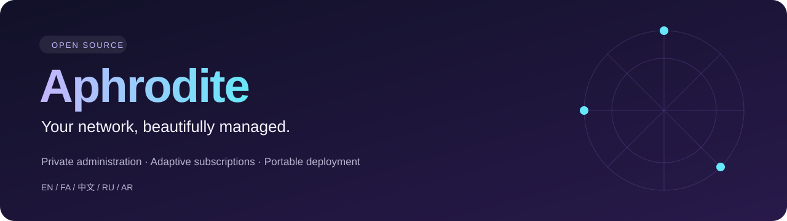

<p align="center"></p>

<p align="center">
<a href="https://github.com/MiRHaDi/Aphrodite/releases"></a>
<a href="https://github.com/MiRHaDi/Aphrodite/actions/workflows/ci.yml"></a>
<a href="LICENSE"></a>

</p>

<p align="center"><b>A five-language workspace for private network administration and adaptive subscriptions.</b><br>
<a href="README.fa.md">فارسی</a> · <a href="#start-here">Get started</a> · <a href="https://github.com/MiRHaDi/Aphrodite/releases">Downloads</a> · <a href="#documentation">Documentation</a> · <a href="SECURITY.md">Security</a></p>

## A clear view of your network

Aphrodite brings account management, subscription delivery and connection settings into one workspace. Organize users, configure authorized routes and distribute client profiles from a responsive interface available in English, Persian, Chinese, Russian and Arabic.

| Manage | Connect | Operate |
|---|---|---|
| User limits and expiry | Adaptive client routing | Cloudflare Workers and Pages |
| Connection settings | Multiple subscription formats | D1-backed configuration |
| Audit and backup workflows | Configured origin failover | Portable installer in the 2.0 beta |
| Five-language interface | Configured country exits | Documented validation boundaries |

## Start here

Choose a release before deploying. The default branch and the portable beta are separate release channels.

| Channel | Best for | Download and guide |
|---|---|---|
| **1.5 workspace** | Existing gateway workflows and the five-language interface | [Stable releases](https://github.com/MiRHaDi/Aphrodite/releases/latest) · [Deployment](docs/DEPLOYMENT.md) |
| **2.0 portable beta** | Native accounts and token-driven installation | [Beta releases](https://github.com/MiRHaDi/Aphrodite/releases) · [Installer guide](https://github.com/MiRHaDi/Aphrodite/blob/codex/portable-installer/docs/INSTALLER.md) |

For the portable beta, download and extract its installer ZIP, then run:

```powershell
# Windows / PowerShell
.\install.ps1 --provider workers
```

```bash
# Linux / macOS
bash install.sh --provider pages
```

The installer prompts for credentials and builds the deployment. Other beta destinations are Railway, Render, Docker and VPS over SSH. Render requires a paid persistent-disk plan; local Docker requires a running daemon. Similar hosts can use the Docker bundle. [Read prerequisites and limits first](https://github.com/MiRHaDi/Aphrodite/blob/codex/portable-installer/docs/INSTALLER.md).

## How it fits together

```text
Client applications
        |
        v
Aphrodite subscription gateway + management workspace
        |
        +-- Account and route storage
        +-- Native transport in the portable beta
        +-- Authorized upstreams and configured country exits
```

Country selection requires a working exit in that country. Adaptive routing uses configured client rules; it does not guarantee access to every website. Hosted HTTP/WebSocket runtimes do not automatically become WireGuard or OpenVPN servers.

## Private by configuration

The portable beta uses a configured private management path and bearer authentication. New users receive random subscription links; retained legacy links follow the existing installation policy. Keep tokens, user credentials and real deployment configuration out of Git. Consult the [private entry-point guide](https://github.com/MiRHaDi/Aphrodite/blob/codex/portable-installer/docs/PRIVATE_ENTRYPOINTS.md) for beta behavior.

## Documentation

| Task | Guide |
|---|---|
| Deploy the workspace | [English](docs/DEPLOYMENT.md) · [فارسی](docs/DEPLOYMENT.fa.md) |
| Install the portable beta | [English](https://github.com/MiRHaDi/Aphrodite/blob/codex/portable-installer/docs/INSTALLER.md) · [فارسی](https://github.com/MiRHaDi/Aphrodite/blob/codex/portable-installer/docs/INSTALLER.fa.md) |
| Understand the design | [Architecture](docs/ARCHITECTURE.md) · [Features](docs/FEATURES.md) |
| Deploy on Pages | [Pages guide](docs/PAGES.md) |
| Report a vulnerability | [Security policy](SECURITY.md) |
| Contribute | [Contribution guide](CONTRIBUTING.md) |

## Validation and release status

**Final 2.0 release is currently blocked by live Cloudflare validation.** The fresh installation later returned HTTP 500, including with a minimal control program; the saved token also lacks Pages access. See [the live validation report](docs/CLOUDFLARE_VALIDATION.md) and [client profile negotiation](docs/CLIENT_PROFILES.md). Current source validation: 77 tests, TypeScript, and Node/Miniflare bundled integration tests passed.

The 2.0 installer snapshot passed 50 tests, TypeScript checks, and Node/Miniflare integration tests covering private management, account creation, subscription formats, authenticated WebSocket and quota reservation/refund. Live provider adapters, Docker container execution and performance across ISPs remain unverified for that snapshot. Each portable installation has independent accounting.

Release notes describe the exact published revision. A beta label means additional deployment validation is needed; it is not a claim of production readiness.

## Development

```bash
npm ci
npm run check
npm test
```

The portable beta requires Node.js 24. Follow the selected release's prerequisites for other versions.

## License

[MIT](LICENSE). Required dependency notices are preserved in [THIRD_PARTY_NOTICES.md](THIRD_PARTY_NOTICES.md).
